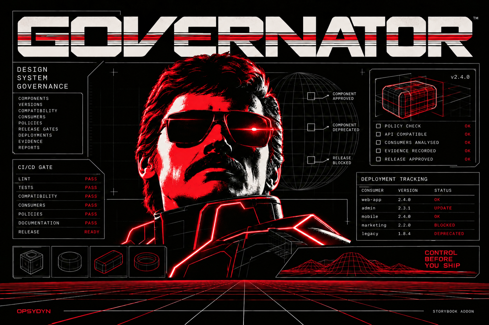

# GOVERNATOR



[](https://github.com/opsydyn/governator/actions/workflows/check.yml)

[Documentation](https://opsydyn.github.io/governator/) · [Storybook demo](https://opsydyn.github.io/governator/storybook/) · [Release status](https://opsydyn.github.io/governator/status/)

[](https://www.npmjs.com/package/@opsydyn/storybook-addon-governator) [](https://www.npmjs.com/package/@opsydyn/governator-cli) [](https://www.npmjs.com/package/@opsydyn/governator-mcp)

Offline design-system governance: a component's status should show its evidence.

The local CLI uses the `governator` command and packages use the `@governator` scope.

The local workspace includes a deterministic policy engine, source-bound Vitest checks, TypeScript declaration compatibility analysis, a Bun CLI, fourteen read-only MCP queries and a real React/Storybook dogfood app. The addon, CLI and MCP are prepared for public release; check the live release dashboard for public registry observations.

## Use in another project

The addon, CLI and MCP are public release candidates at `0.1.0`; npm registry installation has not yet been qualified. Local tarballs are release-preparation artifacts. Start with the [addon-only setup](packages/storybook-addon/README.md) for Storybook React/Vite 10.6.4, or the [Bun CLI quick start](packages/cli/README.md) and [read-only MCP quick start](packages/mcp/README.md). The addon needs only its Storybook peer; CLI/MCP require Bun >=1.4.2 and declared runtime dependencies. Independent clean-consumer results must be recorded separately from workspace builds, with any reconstructed local package source identified.

## Run locally

Use Bun **1.4.2** with pinned Moon **2.6.4**. Documentation is a Moon project with a separate Bun lockfile because the root cached dependency graph cannot resolve Astro offline; install both graphs in the order below.

```sh
bun install --frozen-lockfile
bun run docs:install
bun run check
bun run build
bun run governator validate
# Requires clean, committed source. Rebuilds actual declarations and runs actual UI tests.
bun run dogfood:report
bun run storybook
```

Open http://127.0.0.1:6006, choose a story and its **Governance** tab. Button, Select, Alert and deprecated LegacyAlert are real components in one shared `@example/ui` package. The Unmapped story demonstrates missing identity. Reports are optional; Storybook works before one is generated.

The deliberately removed Button `tone` prop requires a major bump. Proposed contract `1.2.1` and package `8.4.2` patches are blocked. Passing local unit tests can satisfy the explicitly limited dogfood readiness policy while API compatibility stays blocked. This policy is a demonstration of real local evidence, not production design-system acceptance. Publication, deployment and adoption remain unknown.

`bun run check` runs Moon tasks for TypeScript, oxlint with `@opsydyn/oxlint-effect`, oxfmt, Vitest under Bun, generated protocol/validator freshness, protocol dependency boundaries and the built addon dependency/bundle budget. `bun run fallow:dead-code` separately analyzes unused files, exports and dependencies; its configured entry points include the standalone tools, generated protocol and Starlight app. Review findings before deleting files, especially public exports and framework entry points. `bun run storybook:build` produces the static app. These commands do not publish or version packages.

## API commands

```sh
bun run governator contracts snapshot --config governance/api-config.json --declarations packages/demo-ui/dist/index.d.mts > artifacts/candidate.json
# Expected exit 1: removed Button prop and insufficient version bumps.
bun run governator contracts diff --baseline governance/api-baselines/ui-8.4.1.json --candidate artifacts/candidate.json --baseline-digest governance/api-baselines/ui-8.4.1.json.sha256
```

Pinned TypeScript 5.9.3 analyzes actual emitted declarations. Baselines are explicit digest-checked local release fixtures, not authenticated npm releases. The comparison checks exported props, full structural assignability and callable return types; unsupported callable shapes require review, and global/module augmentations are rejected. Static types do not prove behavior, visuals, focus or accessibility compatibility. [Exact candidate and Changesets enforcement](docs/release-candidates.md) now check actual packed files, fresh consumer/test evidence and release intent.

CLI exit codes: **0** satisfied the requested check, **1** blocked/insufficient evidence, **2** invalid input/runtime error. `validate` checks shape, references and contained source paths; it does not approve a component. Normal evaluation uses Git HEAD and rejects dirty inputs. Saved JSON and raw imported test reports do not independently recreate trusted attestations. See [evidence](docs/test-evidence.md).

## Packages

| Package                               | Responsibility                                                      |
| ------------------------------------- | ------------------------------------------------------------------- |
| `@governator/protocol`                | Generated plain TypeScript and JSON Schema; no runtime dependencies |
| `@governator/core`                    | Private Effect schemas, deterministic evaluation and digests        |
| `@governator/versioning`              | Private API extraction/diff, SemVer and baseline checks             |
| `@governator/fixture-attestation`     | Private offline verifier for fixture-signed candidate statements    |
| `@governator/fixture-policy`          | Private synthetic signed reviewer-policy lifecycle model            |
| `@governator/query`                   | Private immutable snapshots and shared read queries                 |
| `@opsydyn/governator-mcp`             | Bun stdio MCP adapter                                               |
| `@opsydyn/governator-cli`             | Bun filesystem, Git, local test runner and presentation boundary    |
| `@opsydyn/storybook-addon-governator` | Independently packed read-only manager panel; sole peer Storybook   |
| `@example/ui`                         | Shared private React library used by the dogfood app                |
| `@governator/storybook-demo`          | Storybook 10.6.4 React/Vite app                                     |

See [architecture](docs/architecture.md), [dogfood and API runbook](docs/storybook-contracts.md), [verification](docs/storybook-contracts-verification.md), [release conventions](docs/releasing.md) and the [handoff](docs/reference/CODEX_HANDOFF_DESIGN_SYSTEM_GOVERNANCE.md).

Local release enforcement: `bun run release:plan` blocks the deliberately insufficient patch; `bun run release:demo` exercises blocked patch/minor and an explicitly simulated reviewed major. Storybook includes release details and lifecycle/readiness sidebar markers. See the [release runbook](docs/release-candidates.md). A separate [single-maintainer local rehearsal](docs/qualification/single-maintainer-release-rehearsal.md) records reviewed first-release archive hashes and simulates transfer without publishing.

Targeted local browser checks and reconstructed-cache consumer tests are recorded in [qualification](docs/qualification/consumer-distribution-verification.md); these do not establish screen-reader or human acceptance. Hosted CI/required-check configuration and authenticated published baselines remain unverified. M2 provides local read-only MCP; see the [launch and snapshot runbook](docs/mcp.md) and [M2 verification](docs/m2-verification.md). External approvals, publication and deployment need trusted adapters.

M3a introduces a private synthetic review-evidence evaluator for testing exact candidate, policy, reviewer-role and freshness bindings. Its results are fixtures only; normal release review stays unconfigured. See [M3a evidence and verification](docs/m3a-verification.md).

M3b adds an inactive [GitHub source-review reader](docs/m3b-verification.md), tested with injected transport fixtures and returning only unverified observations. M3c adds a private [fixture attestation verifier](docs/m3c-verification.md) for exact candidate scope. Its cryptographic match is fixture-only and does not authorize ordinary releases or establish authenticated GitHub review. Independently protected reviewer authority and real-provider qualification remain future work; publication is a separate gate.

M3d models a signed two-owner policy lifecycle with synthetic witnesses and in-memory state. It does not authorize releases. See [M3d verification](docs/m3d-verification.md).
