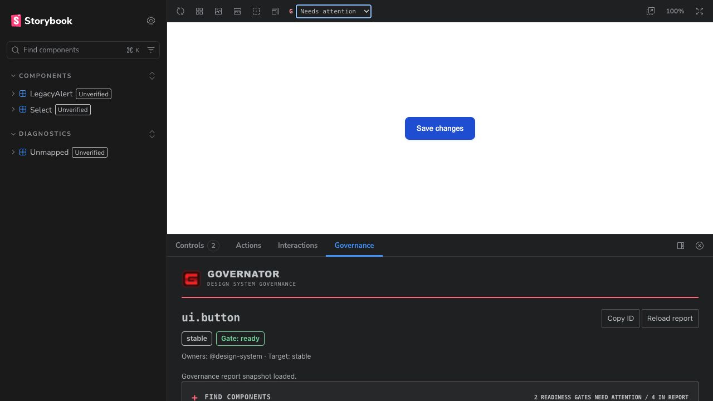
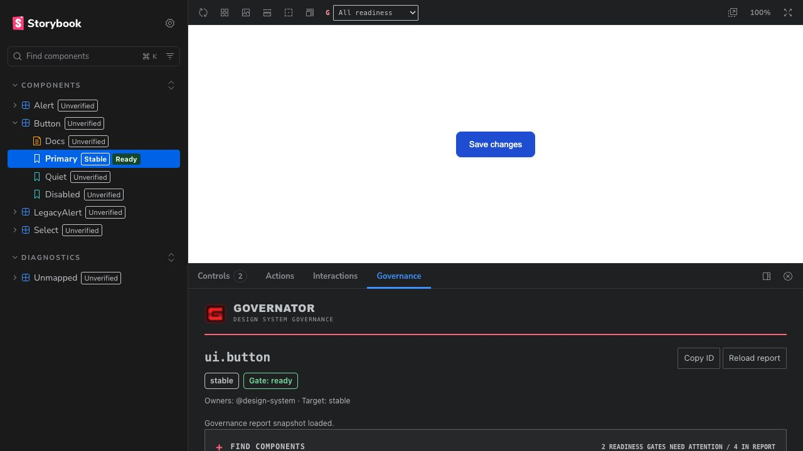
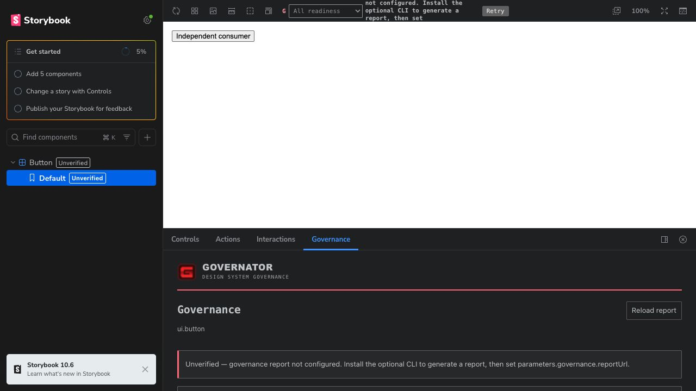
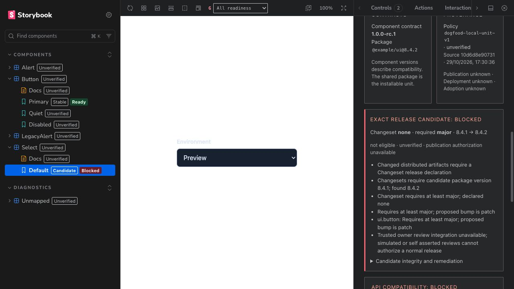
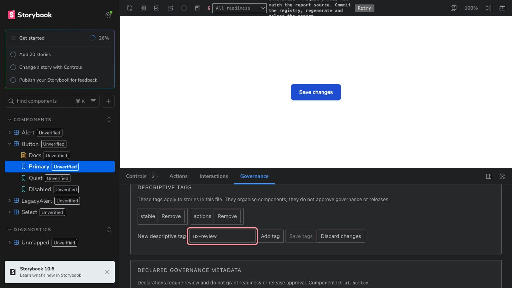

# Governator Storybook UX review

Date: 29 October 2026. Scope: the next UX release, including Storybook acceptance. Status: assessment and proposed direction; implementation is not approved by this document.

Governator has a useful governance model and careful handling of uncertain evidence. Its largest UX obstacle is translating that model into an immediate answer: **what is this component's readiness, why, and what should I do next?** The current panel prioritizes editing and technical detail, while different navigation surfaces can disagree about the same component. A focused UX release is warranted before adding more capabilities.

The recommended direction is a compact, branded Storybook addon that leads with decisions and next actions, supports deliberate local authoring, and provides understandable recovery. Preserve the existing artwork and the distinctions between readiness, release eligibility and publication. Complete human Storybook acceptance within this phase.

## Evidence and limits

Source inspected: `main` at `10d6d8e907311c958e641777cdce412a9e69cc63`. Two independent source reviews covered interaction design and acceptance coverage. Browser observations below used the Codex in-app browser at 1280 × 720, dark theme, Storybook 10.6.4. This is expert inspection, not a user study or accessibility conformance result.

| Surface                                                               | What was inspected                                                                   | What it establishes                                                                                             |
| --------------------------------------------------------------------- | ------------------------------------------------------------------------------------ | --------------------------------------------------------------------------------------------------------------- |
| Local monorepo demo, port 6006                                        | Published addon 0.1.0; actual local tags and metadata forms; source/report mismatch  | Current demo behavior, form layout, tag entry and mismatch recovery presentation                                |
| Independent packed consumer, port 6020                                | Installed retained addon 0.2.0; no report; tag adapter enabled; registry unavailable | Actual candidate's initial no-report rendering, not the configured-report or save acceptance journey            |
| [Deployed Storybook](https://opsydyn.github.io/governator/storybook/) | Read-only demo; report source `10d6d8e90731`, evaluated 2026-10-29T17:30:36.758Z     | Fresh report presentation, sidebar filtering, finder navigation, read-only mode, bottom and right panel layouts |
| Current source and tests                                              | Manager, editors, filters, theme, contracts and qualification records                | Implemented behavior and coverage; source-only findings are identified below                                    |

The local 0.1.0 manager bundle, installed packed 0.2.0 manager bundle and current built manager have the same SHA-256: `844934ae00eb98effb5a5caf2be2e1b3c51cded83d93ce19b0ecdd60b69ac13e`. This supports comparing their manager UI, but does not establish equivalence of server adapters or qualify all 0.2.0 workflows. The public demo remains deliberately pinned to 0.1.0.

No source-file saves were performed in the browser. A temporary tag input was discarded; a native Controls field was changed and reset. Product code, reviewed release archives and publication state were not changed. Screenshots capture the observed states, not proposed designs.

## User tasks that should organize the experience

| User context       | Immediate task                            | Successful outcome                                                                      |
| ------------------ | ----------------------------------------- | --------------------------------------------------------------------------------------- |
| Component consumer | Decide whether a component fits their use | Understand lifecycle, readiness and limitations; inspect the relevant evidence          |
| Contributor        | Resolve a failed or missing requirement   | Find the actual reason, owner and next step without reading the full report             |
| Maintainer         | Update tags or declared metadata          | Know which file and scope will change; validate, save and review the source diff        |
| Reviewer           | Understand a proposed release             | Distinguish component readiness from compatibility, release eligibility and publication |
| New installer      | Get useful information into Storybook     | Follow one accurate guide and reach a meaningful first result                           |

The primary design hypothesis is that showing the decision and useful next action first will reduce interpretation effort. That remains a hypothesis until task-based testing; no completion-time or satisfaction baseline exists yet.

## Findings in priority order

Severity uses an expert estimate of impact, recurrence and recoverability, following [NN/g's severity guidance](https://www.nngroup.com/articles/how-to-rate-the-severity-of-usability-problems/). Here, 3 means a major task obstacle, 2 means meaningful friction and 1 means polish. No severity-4 failure was established. These are prioritization judgments, not measured incidence rates.

### F1 Major — sidebar status and filtering disagree

**Observed:** with a fresh report, Button Primary showed Stable / Ready while its parent, Docs and unvisited sibling stories showed Unverified. Selecting Needs attention correctly removed ready components, but the remaining Select and LegacyAlert entries still showed Unverified. The finder identified both as Blocked. Selecting a story subsequently populated its badge.

**Cause:** [SidebarLabel](../../packages/storybook-addon/src/manager.tsx#L577) relies on loaded `api.getParameters()`; component parents use the first child. The [finder and filter identity join](../../packages/storybook-addon/src/story-navigation.ts#L31) uses the validated source sidecar. Unknown and not-yet-loaded are collapsed into the same visible state.

**Correction:** share a consistent report context and validated identity model across badges, finder and filter. Do not guess identities from names or an arbitrary child. The current sidecar identifies components, not every story's report URL and verification mode: either explicitly scope all surfaces to the selected report or extend the configuration contract before claiming per-story status. Preserve unknown, ambiguous and composed cases. Parent/Docs status needs an explicit aggregation rule.

**Acceptance:** fresh browser session, no prior story visits; mapped stories agree with the selected report and filter. Truly unknown stories remain visibly distinguishable and discoverable. Cover multiple report URLs and verification modes.

### F2 Major — the decision and next action lose priority

**Observed and source-confirmed:** the default 300px bottom panel initially shows branding, identity and status, with little room for the reason. Local tags and the full twelve-field metadata editor precede contracts, compatibility and [evidence/actions](../../packages/storybook-addon/src/manager.tsx#L336). Passing evidence is expanded into IDs, producer, provenance and timestamps. Release-level diagnostics can dominate a component-level task.

**Correction:** make the first view answer identity, readiness, reason and next action. Put local editing behind an explicit action; progressively disclose detailed provenance, contract data and package-release diagnostics. Keep a compact indication of relevant release/compatibility problems so simplification cannot imply approval.

**Acceptance:** users can explain the selected component's readiness and the most useful next step without traversing the editor. They also correctly distinguish Ready from release-approved or deployed.

### F3 Major — toolbar recovery text is clipped

**Observed:** both the local source mismatch and packed no-report state put a multiline explanation into the narrow, fixed-height Storybook toolbar. Its beginning/end are clipped at 1280 × 720. The dropdown is deliberately disabled in these states; this can resemble the previously reported nonresponsive control.

**Cause:** [toolbar status](../../packages/storybook-addon/src/sidebar-toolbar.tsx#L258) renders a wrapping message beside the select, with a Retry button. That space cannot accommodate setup instructions.

**Correction:** use a compact, named status/action that opens an accessible popover or the Governance panel. Put the full reason and recovery there. Differentiate missing configuration, source mismatch, expiry and transient loading; Retry alone cannot create a report or repair a source mismatch. Do not rely on hover-only help.

**Acceptance:** all unavailable states have readable keyboard-accessible guidance; no clipped toolbar text, and no apparent dead control without explanation.

### F4 Major — tag requests can leave the editor stuck

**Source-confirmed:** [tag loading](../../packages/storybook-addon/src/tag-editor-ui.tsx#L42) and [saving](../../packages/storybook-addon/src/tag-editor-ui.tsx#L143) have no bounded timeout. Saving disables editing and discard until completion. A failed response after a successful write is not presented as an uncertain outcome. Metadata already has a more careful bounded-request model.

**Correction:** give tags bounded loading, retryable reads and safe reconciliation after an uncertain save. Preserve drafts. A timed-out write must not be presented as definitely failed or blindly retried.

**Acceptance:** stalled load/save, dropped response and concurrent edit are tested in a disposable repository. The UI remains recoverable and correctly reports whether the source changed.

### F5 Major — metadata errors do not identify the correction

**Source-confirmed:** the [metadata form](../../packages/storybook-addon/src/registry-editor-ui.tsx#L230) uses generic fields; most server rejections become [“Check values and paths”](../../packages/storybook-addon/src/registry-editor-ui.tsx#L185). The user must infer which of twelve values failed and why.

**Correction:** field-specific validation, format examples, an error summary linked to fields and clear optional/required distinctions. Group ordinary ownership/documentation edits separately from paths, contracts and lifecycle changes. Surface server validation safely and keep it authoritative. Show the file and affected scope before save.

**Acceptance:** a user can correct invalid version, URL, owner and path values without external help. Lifecycle/replacement dependencies are understandable; no rejected save modifies the file.

### F6 Major — recovery protects files but makes users sacrifice drafts

**Source-confirmed:** [tag conflicts](../../packages/storybook-addon/src/tag-editor-ui.tsx#L266) and [metadata conflicts/unknown outcomes](../../packages/storybook-addon/src/registry-editor-ui.tsx#L157) direct users to discard and reload. Existing revision checks correctly prevent stale overwrites, but the UI offers no comparison or convenient draft preservation. Drafts survive story/panel changes in memory, not page reloads, with no leave warning.

**Correction:** preserve/copy the draft, show current file versus intended changes, and allow explicit reapplication against a refreshed revision. Give unsaved work a visible indicator and a clear page-leave policy. A minimal draft-copy route is sufficient before considering a richer merge UI; automatic merging is unnecessary.

**Acceptance:** another editor changes the file during a draft. The user understands the conflict, retains their intended values and resolves it without overwriting someone else's work. Test page refresh/close separately from story navigation.

### F7 Major — the installation guide contradicts the product

**Source-confirmed:** the [Starlight setup guide](../../apps/docs/src/content/docs/how-to/storybook-addon.md#L8) still calls 0.1.0 unpublished and directs users to local archives. The [package README](../../packages/storybook-addon/README.md#L3) and installed demo describe published 0.1.0. This undermines the first task before users reach the addon.

**Correction:** one current published-install path; a clearly separate candidate-testing path; concise local-editor and static-reader setup. Link contextual panel help to the exact relevant section. Use base-relative report examples for subpath hosting. Keep conceptual distinctions in explanation pages and exact options in reference pages, preserving the docs' Diátaxis structure.

**Acceptance:** an unfamiliar developer installs the selected version from the guide without repository-specific advice, sees the panel and can enable the intended mode.

### F8 Moderate — normal read-only mode looks like a fault

**Observed:** the deployed demo shows tags followed by “Tag editing is unavailable. Enable the local Storybook tag editor…” A reader is on a functioning static site, yet the presentation suggests missing setup. The packed no-report consumer likewise combines optional setup with unverified/error-like states.

**Correction:** declare **Read-only snapshot** or **Local editing enabled**. Display read-only tags compactly and provide an Edit locally help action when useful. Separate first-time setup from unexpected failure. Avoid showing editor controls until editing is possible and requested.

**Acceptance:** hosted users can identify the mode and still inspect useful evidence; local users understand how saves persist and that Git commit/report refresh are separate steps.

### F9 Moderate — layout responds to window width rather than panel width

**Observed:** moving the addon right produced a 347px content area with two 167.5px contract/provenance columns. Text became narrow and vertically dense. [Responsive rules](../../packages/storybook-addon/src/manager.tsx#L61) switch only when the whole viewport is below 700px; [finder rules](../../packages/storybook-addon/src/brand.ts#L15) make the same assumption.

**Correction:** container-based or intrinsically wrapping layouts. Test the panel independently of the browser window. Long IDs and diagnostics need sensible wrapping; evidence tables need accessible overflow or a narrow-layout alternative.

**Acceptance:** short bottom panel and 320–400px right panel remain usable in a wide desktop window, including long names, 200% zoom and large text. No essential action or error is clipped.

### F10 Moderate — status vocabulary and filter scope require interpretation

**Source-confirmed:** sidebar uses Missing evidence; finder uses Insufficient evidence; panel uses Gate. Readiness and lifecycle chips have different treatments across surfaces. The toolbar filters stories and defaults to all; the finder filters report decisions and defaults to needs attention. Unknown stories intentionally remain visible in the tree, which is explained mainly in hover text.

**Correction:** shared human-readable labels and semantic tokens, with text/icon as well as colour. Explicitly name filter scope, show active filters/counts and provide a clear reset. Keep native tag filtering separate from policy-derived readiness. Never convert a descriptive tag such as stable or release-ready into proof of status.

**Acceptance:** users can explain why an unknown story remains after filtering and can clear readiness, search and tag filters independently. All surfaces use the same status language for the same context.

### F11 Moderate — tag entry misses an expected keyboard action

**Observed:** typing `ux-review` and pressing Enter did nothing; the input stayed populated and Save tags remained disabled. The user must click Add tag and then Save tags. [Input handling](../../packages/storybook-addon/src/tag-editor-ui.tsx#L216) confirms there is no submission/key handler. The format error also omits the accepted characters and length limit.

**Correction:** Enter adds a token; input errors explain the rule; draft versus saved state is clear. Retain an explicit source-file save and show its file/scope. Consider existing-tag suggestions after the basic interaction is sound.

**Acceptance:** keyboard-only add/remove/save/reset, duplicate and invalid input, protected tags, and multiple stories sharing one file. Save persists the correct CSF diff and native tag filtering updates after reindex.

### F12 Moderate — finder navigation does not bring the destination into view

**Observed:** Open Components/Select / Default navigated correctly, but focus and scroll remained deep in the finder; the new component heading was offscreen. The [callback](../../packages/storybook-addon/src/manager.tsx#L328) only selects the story. It also blocks navigation for either editor's dirty state, while the [message](../../packages/storybook-addon/src/discovery.tsx#L100) always refers to tag edits.

**Correction:** after explicit finder navigation, announce and focus the resolved component heading and bring it into view. Identify the actual dirty section and offer a return-to-draft action. Preserve normal Storybook navigation conventions elsewhere.

**Acceptance:** a keyboard user knows where they arrived and can inspect the new decision; pending metadata is described as metadata, not tags.

### F13 Moderate — visual hierarchy is more memorable than comfortable to scan

**Observed/source-confirmed:** the mark, wordmark and red rule establish identity. Many secondary labels use 9–10px uppercase or monospace styling; the header occupies a substantial part of a short panel. Raw IDs and disclaimers compete with decisions. The correct current sidebar labels are already clearer than the old abbreviated screenshot.

**Correction:** retain the provided identity while making operational text comfortably readable. Use a compact brand signature, host typography for ordinary controls, and technical styling selectively for IDs or secondary metadata. Centralize brand and semantic status tokens. Contrast, focus and zoom require measured checks; small typography alone is not a claimed WCAG failure.

**Acceptance:** brand recognition and task success are tested separately. Users recognize Governator while quickly locating the action and accurately interpreting status.

## Coverage against Nielsen Norman heuristics

This is an application of [Jakob Nielsen's ten usability heuristics](https://www.nngroup.com/articles/ten-usability-heuristics/), not a numerical usability score. The findings above are Governator-specific judgments.

| Heuristic focus                  | Preserve                                                  | Main work                                               |
| -------------------------------- | --------------------------------------------------------- | ------------------------------------------------------- |
| H1 State visibility              | Freshness checks, status announcements, explicit unknowns | F1, F3, F4: agreement, readable feedback, bounded waits |
| H2 Familiar language             | Named lifecycle and readiness                             | F2, F10: user task before gate/provenance vocabulary    |
| H3 Escape and undo               | Discard controls, revision guards, in-session drafts      | F6, F12: retain work and orient after navigation        |
| H4 Consistency                   | Storybook registration and theme integration              | F1, F8, F10: consistent meanings and modes              |
| H5 Prevent mistakes              | Protected tags, path validation, stale-write refusal      | F5, F6: guide inputs and expose save scope              |
| H6 Make information recognizable | Visible labels and component finder                       | F2, F7: visible reasons and contextual setup help       |
| H7 Efficient expert paths        | Search, native tags, filter, Copy ID                      | F11, F12: keyboard entry and direct destination         |
| H8 Prioritize essentials         | Scoped branding and disclosures                           | F2, F9, F13: decision hierarchy and panel density       |
| H9 Error recovery                | Fail-closed state and metadata timeout handling           | F3–F6: actionable recovery without draft loss           |
| H10 Contextual help              | Existing docs and explanation of trust limits             | F7, F8: accurate setup and mode-specific assistance     |

## Storybook conventions to adopt deliberately

The addon already uses `AddonPanel`, manager hooks, `api.selectStory`, `useTheme`, toolbar/panel registration and preservation of a previous sidebar renderer. Keep these integrations. Official [addon types](https://storybook.js.org/docs/addons/addon-types) support panels, tools and tabs; a focused panel remains an appropriate home for the component task.

Use **Controls and Args**, not the old Knobs addon. Storybook documents Controls as the interface for changing preview inputs and identifies [Knobs as deprecated](https://storybook.js.org/docs/configure/integration/frameworks-feature-support). Those inputs have a different lifecycle from persisted governance declarations. A lifecycle select should use familiar control styling, but changing a preview arg must never write governance metadata. See [Controls](https://storybook.js.org/docs/essentials/controls).

| Surface              | Proposed convention                                                                   |
| -------------------- | ------------------------------------------------------------------------------------- |
| Toolbar              | Compact named action/filter with active state; keyboard-accessible popover for detail |
| Governance panel     | Host-compatible spacing, focus, buttons, form fields, badges and disclosures          |
| Component playground | Native Controls with useful argTypes, descriptions and appropriate input types        |
| Descriptive tags     | Real CSF tags; native Storybook filtering; preserve built-in and negated tags         |
| Governance edits     | Explicit local draft/save/discard with file, scope and revision awareness             |
| Search/navigation    | Preserve Storybook search, deep links, Docs and keyboard conventions                  |
| Theme                | Follow the host light/dark theme; scope Governator styling to its surfaces            |

Evaluate the primitives exported by the installed Storybook 10.6.4 package for buttons, forms, badges, menus and tooltips. Native HTML is not inherently inferior; choose the control that provides the expected behavior and accessibility. Internal/experimental integrations require tests against the pinned version rather than assumptions about all Storybook versions. [Theming guidance](https://storybook.js.org/docs/configure/user-interface/theming) also distinguishes manager and Docs theming. Keep the consumer's preview styling under their control.

Native [tag filtering](https://storybook.js.org/docs/writing-stories/tags) already supports inclusion/exclusion and interacts with search. Acceptance must exercise that combination with Governator's readiness filter, rather than introducing a second descriptive-tag taxonomy.

## Memorable branding with practical delight

Keep the supplied artwork intact. Its red, charcoal, ivory and technical visual language provides a recognizable identity. Translate that into a small set of reusable UI decisions: a crisp compact monogram, restrained wordmark, strong hierarchy, red accents and consistent status shapes. Test **Governator** as the discoverable panel identity, with governance as its explanation, so users can recognize the addon before opening it. Keep tool names accessible and test the narrow tab strip. The full illustration belongs in the demo introduction/docs or a spacious welcome state, with real status visually distinct from text within the artwork.

Red should identify the brand and support danger styling through distinct tokens; it cannot be the sole meaning of every action or state. Ready, blocked, missing evidence, unverified, lifecycle and draft state need text and non-colour cues. Keep ordinary action labels calm and literal. The brand promise “Control before you ship” can frame the introduction; blocked states should help people resolve the problem.

NN/g describes delight across appearance, useful behavior and the user's sense of accomplishment. Applied here, memorable appearance should be joined by effortless diagnosis and confidence in safe changes. See [Three Pillars of User Delight](https://www.nngroup.com/articles/pillars-user-delight/).

Recommended moments of delight:

- A concise explanation of what changed and what to do next when readiness changes.
- A one-action jump from a failed check to its available evidence or relevant help.
- Keyboard tag entry, predictable focus and drafts that are easy to recover.
- Save feedback naming the changed file and affected stories, followed by the next real step.
- A compact copyable diagnostic context for a teammate or agent, if the selected report supplies the necessary facts. This should not introduce writable MCP, autonomous fixes or background agents.
- Subtle feedback motion only where useful, honoring reduced-motion preferences; task completion must remain clear without animation.

Test recognition after actual tasks, then ask which elements helped or obstructed the work. Attractive visuals can mask task difficulty in subjective ratings, as described by NN/g's [aesthetic-usability effect](https://www.nngroup.com/articles/aesthetic-usability-effect/). Do not use “likes the artwork” as the acceptance criterion.

## Proposed next phase

Three approaches are credible: a visual refresh alone, a focused workflow redesign inside the current addon, or a new full-screen governance workspace. **Recommend the focused workflow redesign.** Styling alone leaves the major issues intact; a new workspace adds navigation and implementation scope before the current tasks are validated. This recommendation is not yet an approved design.

| Order | Deliverable                                                                                                                              | Exit condition                                                                        |
| ----- | ---------------------------------------------------------------------------------------------------------------------------------------- | ------------------------------------------------------------------------------------- |
| 1     | Decision-first panel, coherent report/status model, clear local/read-only modes and compact toolbar recovery                             | F1–F3, F8 and F10 demonstrated in bottom/right layouts; current safety rules retained |
| 2     | Local authoring and recovery: validation, keyboard tags, explicit save scope, bounded requests, draft preservation and destination focus | F4–F6, F11 and F12 pass realistic failure/recovery tasks                              |
| 3     | Shared visual tokens, density/responsiveness, accurate setup/docs, representative demo and final polish                                  | F7, F9 and F13 addressed; no host-theme takeover                                      |
| 4     | Exact-candidate browser, accessibility and human acceptance                                                                              | Matrix below completed and findings resolved or explicitly accepted                   |

Brand design and acceptance planning start with step 1; they are not postponed until the end. Scope remains React/Vite on the supported Storybook version. Hosted control planes, renderer expansion, dual custody, autonomous publishing and a new governance engine remain outside this UX phase.

Proposed research appetite: two short rounds of task sessions, with an initial 3–5 representative users across consumer and maintainer roles and a targeted retest of failures. This is a qualitative learning plan, not statistical proof. Delivery effort should be estimated after choosing the panel structure; no calendar commitment is implied here.

The next concrete design artifact should show the summary, needs-attention state, local editor and recovery state in both short-bottom and narrow-right layouts. Prototype the key tasks, then implement the approved design. Do not overwrite the retained 0.2.0 archives; choose and qualify a new candidate after this phase's changes.

## Acceptance plan for this phase

Historical tests and browser samples remain useful regressions, but do not close the acceptance gate for a new candidate. The [0.2 candidate record](0-2-candidate.md) leaves browser acceptance open. Its independent addon summary records npm/pnpm installation and no-report builds; report-bearing browser qualification remains open. Today's limited inspection adds observations without declaring that gate passed.

The current [rendered panel tests](../../tests/addon-panel-interactions.test.ts#L71) simulate Enter with a click because Happy DOM lacks native activation; manager APIs and theming are mocked. These establish state/focus regressions, not complete manager keyboard behavior. The subpath [preview test](../../apps/storybook-demo/.storybook/preview.test.ts) is also outside the standard Vitest test glob and needs explicit inclusion in the phase's checks.

Use the selected packed addon in disposable repositories for writes. Include fresh, blocked, missing-evidence, unmapped, expired, malformed and mismatched-source reports; readiness-ready/release-blocked; deprecated/replacement; unsupported CSF; delayed and uncertain saves; multiple reports; long text and 100+ decisions. Keep synthetic fixture status plainly identified. Never freshen timestamps on old evidence to manufacture a passing current report.

| Task                              | Required evidence and pass condition                                                                                                                                                               |
| --------------------------------- | -------------------------------------------------------------------------------------------------------------------------------------------------------------------------------------------------- |
| Install and reach first value     | Unfamiliar user follows the current published/candidate path, reaches Governance, identifies version/mode and loads a legitimate report; record assistance                                         |
| Interpret a decision              | User states lifecycle, readiness, why, recency and next action correctly; no confusion with release approval or deployment                                                                         |
| Find and navigate                 | Readiness + native tags + search combine/reset predictably; unknown stories remain understandable; correct destination and focus                                                                   |
| Use component Controls            | Args change the preview and reset normally; no governance file mutation; Docs and other addons still operate                                                                                       |
| Edit tags                         | Keyboard add/remove/validate/save; exact CSF diff; correct file scope; reindex and refresh show persistence                                                                                        |
| Edit metadata                     | Field errors are actionable; save affects only intended record; source mismatch invalidates status; real commit/regeneration restores it                                                           |
| Recover drafts/conflicts          | Story/panel navigation, browser leave, external edits and late responses preserve informed control; no silent overwrite                                                                            |
| Recover unavailable data          | Loading, timeout, missing/invalid/expired report and mapping failure provide distinct useful actions; recovery preserves focus                                                                     |
| Browse static output              | Intentional read-only state, useful tags/evidence, subpath URLs and assets; no writes or misleading availability                                                                                   |
| Keyboard and assistive technology | Actual manager traversal, dropdowns, disclosures, error summary, table, save/reload and focus recovery; test VoiceOver with a named browser and a second combination if supported resources permit |
| Layout and appearance             | Light/dark, 300px bottom panel, 320–400px side panel, narrow sidebar, 200% zoom, long text, reduced motion and measured contrast; essential controls remain available                              |
| Brand and practical value         | Users recognize Governator and complete core tasks; capture hesitation, wrong interpretation and workarounds separately from visual preference                                                     |

Record package version, archive digest, source commit, Storybook/browser version, fixture, local/static mode, viewport, result and evidence for every scenario. Published 0.1.0 demo, current source and candidate acceptance must remain clearly distinguished.

Proposed release gates:

- No unresolved major task blocker or silent draft loss; status/freshness/source semantics remain truthful.
- Every critical scripted journey passes against the exact selected candidate. Builds and mocked tests alone are insufficient.
- In human sessions, all participants correctly distinguish readiness from publication/approval; core reading and editing tasks have no unresolved recurring failure. Record assisted and unassisted outcomes rather than converting a small sample into a success percentage.
- Keyboard and named assistive-technology checks complete; measured contrast and layout issues resolved. Do not label this formal WCAG conformance without the corresponding audit.
- Documentation and demo reflect the version actually being accepted. Preserve exact candidate archives after qualification; publication remains a separate decision.

Initial timing targets, to test rather than assume: identify readiness and its reason within 30 seconds, find a blocked component and its next action within 60 seconds, and make a routine tag edit without help. Establish the baseline during the first sessions; revise layout or terminology if users repeatedly misinterpret status even when the controls technically work.

## Observed successes to retain

The live readiness dropdown opened and changed selection using arrow keys and Enter. Needs attention removed the ready component groups and retained unknown entries. Finder navigation reached the correct Select story. Reload report retained focus during loading. Native Controls remained available and its edited field reset. Tags were available in read-only output; a local unsaved input could be discarded with focus returned to the field.

Source also preserves protected tags, revision checks, source/freshness validation, unknown-state filtering, in-session drafts, explicit governance limits and scoped host-theme integration. These are a strong foundation. The next phase should make their value easy to perceive and use, then close the acceptance work that has deliberately remained open.
